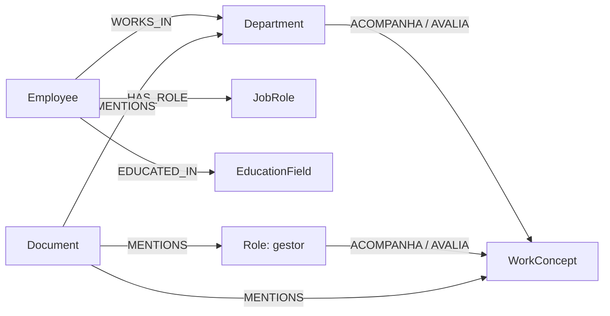

# HR Intelligence — Sistema RH com Neo4j

Integra os 1.470 registros do dataset IBM HR Employee Attrition às políticas fictícias de `documents/`. Interface em português para extração, busca híbrida, consultas com múltiplos saltos e análise de grafos.

## Executar

Requisitos: Python 3.12, Neo4j 5.15+ e acesso à internet no primeiro download dos modelos. Não requer APOC nem Graph Data Science.

```powershell
python -m venv .venv
.venv\Scripts\Activate.ps1
python -m pip install -r requirements.txt
Copy-Item .env.example .env
# Configure as credenciais do Neo4j em .env
python -m src.import_graph
python -m streamlit run app.py
```

A interface também permite importar/atualizar os dados. Execute os comandos na raiz do repositório. O CSV deve estar em `data/WA_Fn-UseC_-HR-Employee-Attrition.csv`. Nunca versione o `.env`.

No Windows, `./run.ps1` inicia a interface usando o ambiente disponível. Nesta máquina foi preparado um runtime local ignorado pelo Git (`.runtime_python`), pois o `.venv` existente apontava para um interpretador ausente. Em outra máquina, siga a instalação acima.

## Funcionalidades

| Tela | Comportamento |
| --- | --- |
| Visão geral | Importação, contagens e visualização do grafo |
| Entidades e relações | Inspeção dos documentos e teste livre com nomes normalizados, offsets e evidências |
| Busca híbrida | Embeddings multilíngues de 384 dimensões + busca full-text; fusão RRF e posições de cada canal |
| Múltiplos saltos | Funcionário → departamento → conceito → documento; colegas; conceitos entre áreas; políticas até cargos |
| Algoritmos | PageRank, comunidades Louvain e caminho mais curto com direção opcional |

## Modelo do grafo



`JobRole` é o cargo informado pelo CSV. `Role` é o papel genérico mencionado nos documentos; a aplicação não inventa vínculos de chefia. `RH`, `Recursos Humanos` e `Human Resources` são normalizados para o mesmo departamento.

A extração usa spaCy `pt_core_news_lg`, vocabulário explícito e dependências sintáticas para os verbos acompanhar/avaliar, incluindo infinitivos e voz passiva. Preserva a frase de evidência e ignora negações reconhecidas. Não é um extrator irrestrito: novos conceitos e ações precisam ser adicionados ao vocabulário/regras; ambiguidades do parser exigem revisão humana. A tela permite essa inspeção.

A importação cria constraints e índices `document_vector`/`document_fulltext`, aguarda sua disponibilidade e utiliza `MERGE`. Reimportar substitui as relações/evidências e menções de cada documento processado, e atualiza os vínculos dos funcionários. Documentos e funcionários removidos dos arquivos não são excluídos automaticamente do banco. Bases antigas com chaves duplicadas precisam ser corrigidas antes de criar as constraints.

A busca usa a mesma pergunta nos dois canais, sem operadores Lucene do usuário. Combina até 20 candidatos por canal com `RRF = Σ 1/(60 + posição)` e retorna o limite escolhido. O score representa ordenação, não probabilidade. As procedures de busca mantêm compatibilidade com Neo4j 5; versões recentes também oferecem a cláusula SEARCH ([documentação Neo4j](https://neo4j.com/docs/cypher-manual/current/indexes/search-indexes/)).

PageRank usa power iteration com amortecimento 0,85, teletransporte uniforme e redistribuição dos nós sem saída. Louvain usa [NetworkX](https://networkx.org/documentation/stable/reference/algorithms/generated/networkx.algorithms.community.louvain.louvain_communities.html), grafo não direcionado, resolução ajustável e semente 42. Louvain é a alternativa implementada para Louvain/Leiden. Caminho mais curto usa BFS em arestas de peso unitário. Os algoritmos carregam todos os nós do domínio e suas relações na memória, sem truncamento; a visualização limita a 100 nós. Evidências repetidas do mesmo par não aumentam seu peso. PageRank não mede desempenho de funcionários, e comunidades são agrupamentos estruturais, não classificação de pessoas.

## Validar

```powershell
python -m pytest -q
python -m src.test_connection
python -m src.test_spacy
python -m src.test_hybrid_search "Como evitar a sobrecarga de trabalho?"
```

Os testes unitários cobrem extração real (são pulados se spaCy/modelo estiver ausente), RRF, normalização de PageRank, comunidades e caminhos sem conexão. Os testes de integração são opt-in e usam a base já importada:

```powershell
$env:RUN_NEO4J_TESTS = "1"
python -m pytest -q -m integration
```

Módulos em `src/` não abrem conexões, carregam modelos ou alteram o banco ao serem importados. Os antigos scripts `test_*.py` são entradas manuais; os testes automatizados ficam em `tests/`.
